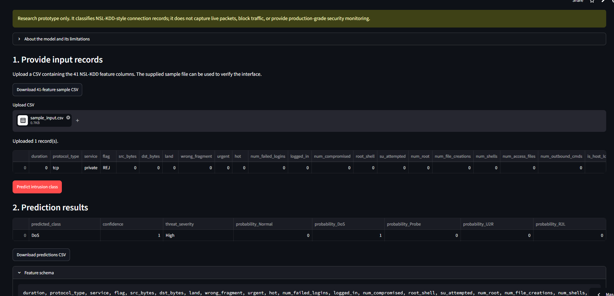

# Group 19 | Machine Learning-Based Network Intrusion Detection

**Course:** FUSE AI-201 - AI Model Development and Implementation  
**Assignment:** Module 6 - AI Deployment, Monitoring, Support and Maintenance  
**Project:** Real-Time Network Intrusion Detection Using Machine Learning-Based Multi-Class Classification

> **Public Streamlit demonstration:** [https://group19-network-intrusion-detection.streamlit.app/](https://group19-network-intrusion-detection.streamlit.app/)  
> **Public GitHub repository:** [https://github.com/adugnaNecho/Group19-network-intrusion-detection](https://github.com/adugnaNecho/Group19-network-intrusion-detection)
>
> **Prototype scope:** This is a research prototype that classifies NSL-KDD-style connection records. It does not capture live packets, block traffic, or provide production-grade security monitoring. Predictions require analyst interpretation; confidence scores are not calibrated guarantees.

## 1. Project purpose

The prototype classifies connection-level records into five classes: **Normal, DoS, Probe, U2R, and R2L**. It uses a Random Forest model in an imbalanced-learn pipeline with SMOTENC, numerical imputation/scaling, and categorical imputation/one-hot encoding.

The deployed Streamlit interface accepts a CSV containing the 41 NSL-KDD model features and returns the predicted class, maximum class probability (displayed as confidence), threat-severity label, and probabilities for all five classes. It also provides a sample input download and a prediction-results CSV download. The Analytics Dashboard tab shows validation-versus-independent-test metrics, class-wise test results, the measured 5 × 5 confusion matrix and one-versus-rest false-positive rates when these are present in `artifacts/evaluation.json`. The validation/test comparison uses grouped bars on a 0–100% axis. Class metrics, recall and false-positive-rate charts, and confusion-matrix rows/columns share the fixed order Normal, DoS, Probe, U2R, R2L; support counts display as integers and false-positive rates as percentages. After a CSV is scored, the dashboard also summarizes predicted class/severity counts, uploaded byte/count features by record order, and maximum class probabilities. An optional FastAPI interface is included in the source repository.

## 2. Dataset and evaluation

Training and benchmark evaluation use public NSL-KDD files (`KDDTrain+` and `KDDTest+`) retrieved with KaggleHub (`hassan06/nslkdd`). The recorded dataset contains 125,973 training records and 22,544 independent test records. The 41 model input features are mapped to five target classes.

A stratified validation split is made from `KDDTrain+` with `test_size=0.1765` and `random_state=42`: 103,738 training records and 22,235 validation records. `KDDTest+` is reserved for final evaluation. SMOTENC is included inside the model training pipeline; validation and independent test rows are not oversampled.

### Latest training run

The values below are from the successful `python train_model.py` execution reported by the group.

| Metric | Validation split | Independent KDDTest+ |
|---|---:|---:|
| Accuracy | 99.89% | 74.62% |
| Macro precision | 97.17% | 79.35% |
| Macro recall | 99.46% | 48.71% |
| Macro F1 | 98.26% | 51.51% |

Independent-test class recall:

| Class | Recall |
|---|---:|
| Normal | 97.28% |
| DoS | 76.57% |
| Probe | 53.52% |
| U2R | 8.96% |
| R2L | 7.20% |

The gap between validation and independent-test scores is substantial. In particular, U2R and R2L recall are low. The prototype should not be used as the sole security control or for automatic blocking. The latest training output did not print the overall maximum class false-positive rate; refer to `artifacts/evaluation.json` for the recorded class-wise false-positive rates before quoting that metric.

## 3. Public prototype

**Live application:** [https://group19-network-intrusion-detection.streamlit.app/](https://group19-network-intrusion-detection.streamlit.app/)  
**Source repository:** [https://github.com/adugnaNecho/Group19-network-intrusion-detection](https://github.com/adugnaNecho/Group19-network-intrusion-detection)

The group reports that the hosted application was opened, a CSV was uploaded, and a prediction was generated. The supplied demonstration screenshot shows one illustrative record classified as **DoS**, with displayed confidence **1.00** and severity **High**. This is a functional interface demonstration for one record, not an independent measurement of prediction correctness, calibration, or generalization.

### User workflow

1. Open the Streamlit application.
2. Download the sample 41-feature CSV or prepare a CSV with the complete required feature schema.
3. Upload the CSV.
4. Select **Predict intrusion class**.
5. Review predicted class, confidence, threat severity, and per-class probabilities.
6. Download the prediction results as CSV.



*Figure: Group-provided screenshot of the deployed interface. The shown prediction is a one-record example and should not be interpreted as proof that the label is correct.*

## 4. Repository contents

```text
.
├── app.py                       # Streamlit CSV prediction and analytics dashboard
├── nids_dashboard.py            # Evaluation and uploaded-record analytics helpers
├── api.py                       # Optional FastAPI inference API
├── nids_core.py                 # 41-feature schema, validation and inference
├── train_model.py               # Reproducible training, evaluation and export
├── examples/sample_input.csv    # Constructed illustrative input row
├── notebooks/                   # Module 5 implementation notebook
├── artifacts/                   # Model and evaluation artifacts in public GitHub repo
├── docs/                        # Portfolio, retrospective, plan, statement, video script
├── tests/                       # Input, dashboard and API tests
├── Dockerfile
├── requirements.txt
└── requirements-dev.txt
```

The actual `.joblib` model, class mapping, `evaluation.json`, and SHA-256 sidecar are published in the public GitHub repository under `artifacts/`. The portable ZIP supplied with this documentation includes the source and evidence screenshot, but not a second copy of the binary model; use the public repository as the canonical model-artifact location.

## 5. Run locally

The group's tested local environment is **Python 3.12.3**. Keep model dependencies aligned with the versions used to serialize the model because scikit-learn/joblib artifacts can be version-sensitive.

```bash
python -m venv .venv
# Windows Git Bash: source .venv/Scripts/activate
# Windows PowerShell: .venv\Scripts\Activate.ps1
# macOS/Linux: source .venv/bin/activate
python -m pip install --upgrade pip
pip install -r requirements.txt
```

The training/inference versions used in the group's local environment were NumPy 2.3.5, pandas 2.2.3, scikit-learn 1.8.0, imbalanced-learn 0.14.1, joblib 1.5.3, and Streamlit 1.66.1. `requirements.txt` pins the core model packages and Streamlit.

### 5.1 Train and export (optional)

If rebuilding the model, place `KDDTrain+.txt` and `KDDTest+.txt` in `data/`, or allow KaggleHub to download the public dataset:

```bash
python train_model.py
```

This creates the model pipeline, class mapping, evaluation report, and SHA-256 file in `artifacts/`.

### 5.2 Run Streamlit locally

```bash
streamlit run app.py
```

Open the local URL printed by Streamlit, normally `http://localhost:8501`.

### 5.3 Run the optional FastAPI endpoint

```bash
uvicorn api:app --reload
```

- `GET /health` reports whether the model artifact is present.
- `GET /schema` returns the required feature names.
- `POST /predict` accepts JSON records with the required features.
- `/docs` provides interactive API documentation.

### 5.4 Run tests

```bash
pip install -r requirements-dev.txt
python -m pytest -q
```

The latest dashboard refinement was checked with **28 automated tests passed** in the preparation environment: original feature/input validation and API tests plus dashboard metric loading, class distribution, traffic-profile and confusion-matrix handling. These software tests are not a substitute for independent model performance evaluation.

## 6. Analytics dashboard

The dashboard has two distinct evidence sources. Benchmark metrics, per-class results, confusion matrix and false-positive rates come from the `evaluation.json` emitted by `train_model.py`; if that artifact is missing, the app uses a clearly disclosed snapshot of the latest reported training metrics and does not invent matrix/FPR values. The validation/test comparison uses grouped bars rather than stacked bars. Class metrics, recall, false-positive-rate charts and confusion-matrix axes use the same fixed class order: Normal, DoS, Probe, U2R, R2L. Support values are formatted as integer counts and false-positive rates as percentages. Uploaded-record charts are calculated from the current CSV and prediction output. The uploaded-record byte/count plot uses record order because NSL-KDD has no timestamp in this schema; byte values are log-transformed for display only. See `docs/analytics_dashboard_guide.md`.

## 7. Deployment and maintenance

The Streamlit application is deployed at [https://group19-network-intrusion-detection.streamlit.app/](https://group19-network-intrusion-detection.streamlit.app/) from the public GitHub repository. The hosted app provides CSV-based inference. GitHub provides source control and versioned artifacts; Streamlit Community Cloud hosts the interactive application. The FastAPI service and Dockerfile are optional deployment paths, not claimed as separately hosted production services.

The monitoring, drift-detection, retraining, shadow-deployment, fallback IDS, privacy and support processes in `docs/monitoring_support_maintenance.md` are proposed plans for a future controlled pilot. They are not active continuous monitoring services in the current prototype.

## 8. Data disclosure and responsible use

The training/evaluation dataset is public NSL-KDD benchmark data, not newly collected operational traffic. The repository sample CSV is a constructed illustrative input. SMOTENC generates synthetic minority examples only inside model fitting; the validation split and `KDDTest+` evaluation data are not oversampled. Raw benchmark files are not redistributed by this repository.

Do not upload confidential traffic records or sensitive network details to the public demonstration. The interface is a research proof of concept and should not be used to block traffic or make security decisions without independent validation and analyst review.

## 9. Limitations and future work

- The model has a large validation-to-independent-test generalization gap.
- U2R and R2L recall on `KDDTest+` is low (8.96% and 7.20%).
- NSL-KDD is a benchmark dataset and does not establish reliable detection of modern or zero-day attacks.
- The application classifies uploaded connection records; it does not capture packets or block traffic.
- Future work should investigate rare-class errors, class-sensitive objectives, calibration, newer representative data, and controlled pilot evaluation with verified labels.

## 10. Contributors

The Module 5 notebook lists five group members. Individual work-package assignments must be confirmed by the group in `docs/team_contributions.md` before submission; no individual roles are inferred in this README.

## 11. Dataset reference

The notebook uses KaggleHub dataset `hassan06/nslkdd`. A public NSL-KDD mirror is documented at [jmnwong/NSL-KDD-Dataset](https://github.com/jmnwong/NSL-KDD-Dataset). Original reference: M. Tavallaee, E. Bagheri, W. Lu and A. A. Ghorbani, “A Detailed Analysis of the KDD CUP 99 Data Set,” IEEE Symposium on Computational Intelligence for Security and Defense Applications, 2009. Review dataset-host terms before redistributing raw benchmark files.

## 12. License

The MIT license in this repository applies to project code and documentation authored by Group 19. Third-party datasets and components remain subject to their own terms.
