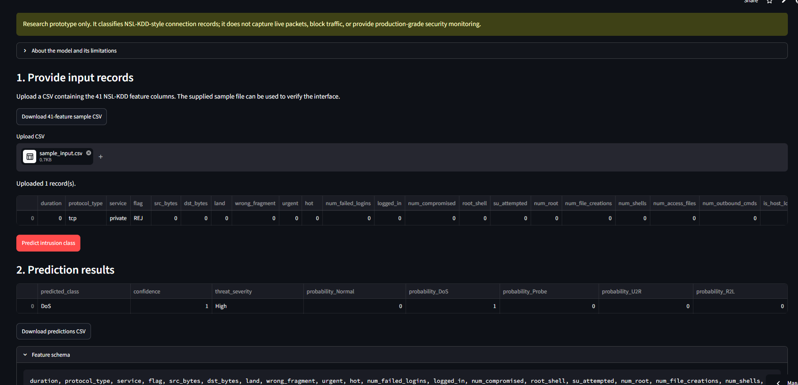

# Evaluation Evidence and Limitations

## Dataset and split protocol

The model uses public NSL-KDD `KDDTrain+` and `KDDTest+` files. The data contain 125,973 training records and 22,544 independent test records, each with 41 input features plus label/metadata. Raw labels are grouped into five classes: Normal, DoS, Probe, U2R and R2L.

A stratified validation split is formed from `KDDTrain+` with `test_size=0.1765` and `random_state=42`: 103,738 training records and 22,235 validation records. `KDDTest+` is held out for final evaluation. Numeric and categorical preprocessing is inside the model pipeline. SMOTENC is inside the training pipeline so synthetic resampling is applied only when fitting the training partition.

## Latest training run reported by the group

The following values are transcribed from the successful `python train_model.py` output shared by the group on November 2, 2026 (local time).

| Metric | Validation split | Independent KDDTest+ |
|---|---:|---:|
| Accuracy | 99.89% | 74.62% |
| Macro precision | 97.17% | 79.35% |
| Macro recall | 99.46% | 48.71% |
| Macro F1 | 98.26% | 51.51% |

### Independent-test recall by class

| Class | Recall |
|---|---:|
| Normal | 97.28% |
| DoS | 76.57% |
| Probe | 53.52% |
| U2R | 8.96% |
| R2L | 7.20% |

The most important limitation is the generalization gap: validation Macro F1 is 98.26%, while independent KDDTest+ Macro F1 is 51.51%. U2R and R2L recall are especially low. The latest console output did not show the aggregate maximum class FPR; consult the generated `artifacts/evaluation.json` before reporting that metric. The model should not be the sole basis for security decisions and must not be used for automatic traffic blocking.

## Hosted prototype demonstration

**Public application:** [https://group19-network-intrusion-detection.streamlit.app/](https://group19-network-intrusion-detection.streamlit.app/)  
**Public source repository:** [https://github.com/adugnaNecho/Group19-network-intrusion-detection](https://github.com/adugnaNecho/Group19-network-intrusion-detection)

The group reports that the hosted Streamlit application installed its dependencies, accepted an uploaded CSV, and generated a prediction. The accompanying screenshot shows one uploaded record classified as **DoS**, with displayed confidence **1.00** and severity **High**. The screenshot demonstrates that the app's input-to-output path worked for that record; it does not prove the prediction is correct or that the confidence score is calibrated.

## Test evidence

The group reported **10 automated tests passed** (`python -m pytest -q`). The tests cover feature schema/input validation, invalid and missing fields, prediction-output formatting using a deterministic test double, and API request/schema behavior. These are software tests, not model accuracy tests. The public app was separately exercised with an uploaded CSV in the group-provided demonstration.

## Interpretation

The validation results do not transfer fully to the independent KDDTest+ data. Class-wise metrics reveal that aggregate accuracy hides weaknesses for the minority U2R and R2L groups. Possible explanations include distribution differences between the training and test benchmark, sparse minority-class examples, and overlapping feature patterns; these are hypotheses for further study rather than proven causes.

The hosted app is a research prototype for uploaded NSL-KDD-style connection records. It does not ingest live traffic, capture packets, block connections, or provide production-grade monitoring. The displayed maximum class probability should not be interpreted as a calibrated probability of a real-world threat.

## What has and has not been tested

- **Model evaluation:** the latest training run reported validation and independent KDDTest+ metrics above.
- **Application demonstration:** the group-provided screen capture shows a one-record CSV upload and a DoS/High output in the hosted Streamlit interface.
- **Automated software tests:** 10 tests passed locally, as reported by the group.
- **Not established:** modern enterprise traffic performance, zero-day detection, live packet capture, automated enforcement, calibrated confidence, continuous drift monitoring, or production availability/SLA.

## Next experiments

1. Investigate R2L/U2R false negatives and false-Normal predictions using training-only cross-validation.
2. Compare class-sensitive objectives, controlled resampling, calibrated outputs and anomaly-detection baselines.
3. Use more representative, authorized and appropriately labelled datasets for a future evaluation.
4. Keep an independent final test set untouched until model selection is complete.
5. Evaluate the public app with a multi-record sample CSV and document exact row count, response, errors and download behavior.
